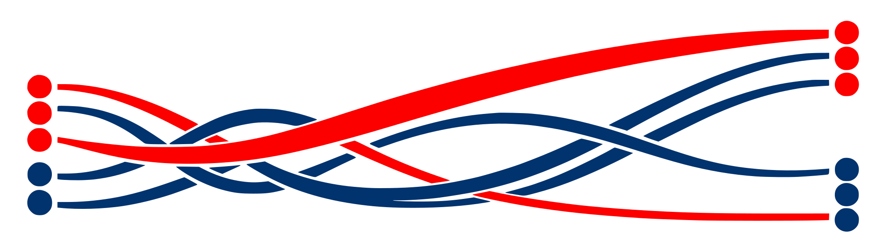

<!-- Generated from publishing/site/ by Jekyll. Run make update; edit the catalogue or templates. -->
# Sharp density thresholds for finite two-visit scheduling

Fabian Fetik · Preprint · 1 October 2026 · v1 · cs.DM / math.CO / cs.DS

Each task must occur exactly twice, with a positive integer deadline bounding its first visit and the gap between visits. The paper gives sharp density bounds and a constructive scheduling algorithm.

**[Read paper (PDF, v1)](https://fabianfetik.github.io/math/two-visits/two-visits-v1.pdf)** · [Paper page](https://fabianfetik.github.io/math/two-visits/)

## Supplementary material

[Download complete package (ZIP, v1)](https://zenodo.org/records/23089289/files/two-visits-v1.zip?download=1)

| Material | Contents |
| --- | --- |
| [Manuscript source](https://github.com/fabianfetik/math/tree/two-visits-v1/two-visits/v1/source) | Markdown, TeX, figure and build instructions |
| [Algorithm and checker](https://github.com/fabianfetik/math/tree/two-visits-v1/two-visits/v1/code) | Constructor and independent output-certificate checker |
| [Exact checks](https://github.com/fabianfetik/math/tree/two-visits-v1/two-visits/v1/checks) | Bounded scheduling and symbolic checks |

The proofs are analytic. The supplied programs include the construction algorithm, an independent certificate checker and bounded exact checks. Reproduction instructions and the complete data are included in the supplementary package.

For the complete release, including any bundled data archives, use the ZIP.
The package READMEs and manifests describe that complete download.

## Citation

Fetik, F. (2026). *Sharp density thresholds for finite two-visit scheduling* (v1). Zenodo. [https://doi.org/10.5281/zenodo.23089289](https://doi.org/10.5281/zenodo.23089289)

## License

The article, documentation and supporting data are licensed under
[CC BY 4.0](https://creativecommons.org/licenses/by/4.0/); supplied software and
local Lean sources are licensed under MIT. The complete package contains the
precise license allocation and full texts.
